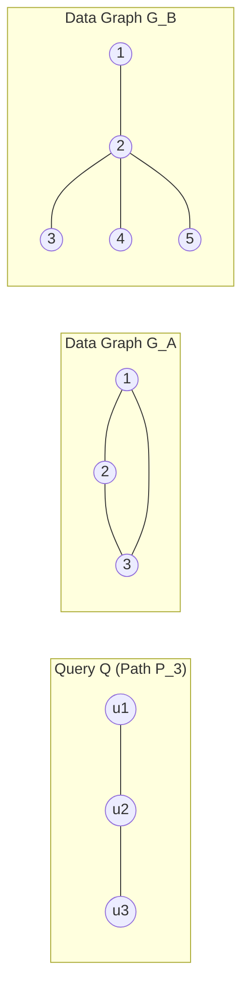

# APX-01: Structural Deviation Models — Candidate Analysis & Evaluation

- **Document Version:** `1.0.0-PROPOSAL`
- **Gate:** Gate A0 (APX-01 — Semantics & Threshold Selection Protocol)
- **Status:** DRAFT WORKING SPECIFICATION / FOR PEER & ADVISOR REVIEW
- **Parent Issue:** [#12 — [APX-01] Gate A0: Approximate CSM Semantics & Threshold Selection Protocol](https://github.com/iamqthanq/Seminar_RapidFlow/issues/12)
- **Repository Target:** `iamqthanq/Seminar_RapidFlow` (Integration base: `QuangThang`)
- **Author:** Senior Graph Algorithms Researcher & Research Software Engineer

---

## 1. Scope & Analytical Objectives

This document provides a comparative mathematical, topological, and algorithmic analysis of candidate structural deviation models for **Approximate Continuous Subgraph Matching (Approximate CSM)**.

The central challenge is to translate the advisor's informal concepts ("patterns with extra tails", "patterns with slightly altered hub branches", "patterns close to query $Q$") into rigorous, computable objective functions that:
1. Avoid collapsing into a trivial subset of exact non-induced matchings;
2. Remain computationally feasible on dynamic graph streams;
3. Behave predictably across diverse query topologies (stars, trees, cycles) and vertex degree distributions (especially NetFlow hubs).

---

## 2. Comprehensive Catalog of Candidate Deviation Functions

### 2.1. Model M: Missing-Edge Deviation ($m_t(f)$)

#### Mathematical Formula
Let $Q = (V_Q, E_Q, \ell_Q)$ and $G_t = (V_t, E_t, \ell_t)$. For an injective mapping $f: V_Q \to V_t$:

$$m_t(f) = \sum_{\{u, v\} \in E_Q} \mathbf{1}\left[\{f(u), f(v)\} \notin E_t \;\lor\; \ell_t(\{f(u), f(v)\}) \ne \ell_Q(\{u, v\})\right]$$

- **Physical Units:** Integer count of missing or label-mismatched query edges.
- **Cost Domain:** $m_t(f) \in \{0, 1, 2, \dots, |E_Q|\}$.
- **Edge Label Convention:** A present edge between mapped vertices with a mismatched edge label is counted as missing ($\mathbf{1}[\dots] = 1$). Such internal edge mismatches strictly belong to internal evaluation and NEVER contribute to external boundary clutter $x_{\mathrm{out},t}(f)$.
- **Acceptance Rule:** $m_t(f) \le \varepsilon_m$.

#### Structural & Algorithmic Analysis
- **Exact Recovery:** For $\varepsilon_m = 0$, Model M requires all query edges to exist, matching exact non-induced subgraph isomorphism.
- **True Inexact Matching:** For $\varepsilon_m \ge 1$, Model M generates genuinely inexact embeddings that are **not** present in the exact matching set ($\mathcal{M}_t^{\varepsilon_m} \not\subseteq \mathcal{M}_t^{\text{exact}}$).
- **Disconnectivity Hazard:** If $Q$ is a tree ($|E_Q| = |V_Q| - 1$), the removal of any edge increases the number of connected components from 1 to 2. Without a secondary connectedness constraint $\mathcal{C}(f)$, setting $\varepsilon_m \ge 1$ causes the search space to explode with arbitrary pairs of disconnected components.
- **Prior-Art Grounding:**
  - *SAPPER (Zhang et al., PVLDB 2010):* Directly utilizes missing edge count $m(f) \le \varepsilon$ for approximate subgraph indexing on large static graphs. SAPPER demonstrates that missing-edge indexing is mathematically coherent, but SAPPER does not penalize extraneous edges.
- **RapidFlow Integration Feasibility:**
  - RapidFlow's `Neighborhood Label Frequency (NLF)` and `GlobalViewManager` assume that all query edges incident to $u$ must exist in $G$.
  - When $\varepsilon_m \ge 1$, NLF checks will prematurely prune valid approximate candidates. Adapting RapidFlow to Model M requires relaxing NLF degree bounds by at least $\varepsilon_m$.

---

### 2.2. Model $X_{\mathrm{in}}$: Internal Extra-Edge Deviation ($x_{\mathrm{in},t}(f)$)

#### Mathematical Formula
$$x_{\mathrm{in},t}(f) = \left|\left\{\{u, v\} \subset V_Q \mid \{u, v\} \notin E_Q \;\land\; \{f(u), f(v)\} \in E_t\right\}\right|$$

- **Physical Units:** Integer count of spurious edges strictly internal to the mapped vertex set $S_f = f(V_Q)$.
- **Cost Domain:** $x_{\mathrm{in},t}(f) \in \left\{0, 1, \dots, \binom{|V_Q|}{2} - |E_Q|\right\}$.
- **Acceptance Rule:** $x_{\mathrm{in},t}(f) \le \varepsilon_{\mathrm{in}}$.

#### Structural & Algorithmic Analysis
- **Relation to Induced Matching:** $x_{\mathrm{in},t}(f) = 0$ is the exact definition of an *induced* subgraph. Setting $x_{\mathrm{in},t}(f) \le \varepsilon_{\mathrm{in}}$ represents a relaxed induced subgraph matching.
- **Blindness to External Clutter:** $x_{\mathrm{in}}$ only inspects the subgraph $G_t[S_f]$. It completely ignores any edges connecting $S_f$ to vertices outside $S_f$.
- **Advisor Intent Disconnect:** If the data graph has a star pattern with 10 extra branches attached to the center vertex connecting to external nodes, $x_{\mathrm{in},t}(f)$ remains exactly $0$. It fails to model the advisor's primary example of extraneous peripheral connections.

---

### 2.3. Model $X_{\mathrm{out}}$: External Extra-Incident Deviation ($x_{\mathrm{out},t}(f)$) [Team-Proposed]

#### Mathematical Formula
$$x_{\mathrm{out},t}(f) = \left|\left\{\{a, b\} \in E_t \mid a \in S_f \;\land\; b \in V_t \setminus S_f\right\}\right|$$

Equivalently, expressed in terms of data vertex degrees:
$$x_{\mathrm{out},t}(f) = \sum_{v \in S_f} \deg_{G_t}(v) - 2 \cdot |E_t[S_f]|$$

- **Physical Units:** Integer count of cut edges incident to the mapped vertex set $S_f$.
- **Cost Domain:** $x_{\mathrm{out},t}(f) \in \mathbb{N}_0$.
- **Strict Boundary Scope:** By definition, $x_{\mathrm{out}}$ only counts edges $\{a, b\} \in E_t$ where $a \in S_f$ and $b \in V_t \setminus S_f$. Any edge between two vertices inside $S_f$ (even if it has an incorrect label or is a spurious chord) is internal and contributes 0 to $x_{\mathrm{out}}$.
- **Attribution & Origin:** This is an original measure proposed by the seminar research team specifically to operationalize the advisor's Week-9 comments. It must **never** be attributed to SAPPER (which ignores extra edges) or NeMa (which uses soft label distance).
- **Acceptance Rule:** $x_{\mathrm{out},t}(f) \le \varepsilon_x$.

#### Structural & Algorithmic Analysis
- **Direct Modeling of Peripheral Tails:** If query $Q$ is a 3-star ($K_{1,2}$, 1 center, 2 leaves) and data graph $G$ contains a 4-star ($K_{1,3}$), mapping $Q$ to the center and 2 leaves leaves 1 leaf unmapped. The edge connecting the center to the unmapped leaf is incident to $S_f$ and outside $S_f$. Thus, $x_{\mathrm{out}} = 1$. This matches the advisor's example.
- **Hub Penalization Vulnerability:**
  - NetFlow contains vertices with degree up to $49{,}014$. Over 414 vertices have $\deg \ge 1{,}000$.
  - If a query vertex maps to a NetFlow hub with $\deg = 20{,}000$, $x_{\mathrm{out},t}(f)$ will be at least $19{,}990$.
  - Under any small integer threshold (e.g. $\varepsilon_x \le 5$), **all embeddings touching NetFlow hubs will be categorically disqualified**.
  - *Scientific Implication:* If the runtime drops dramatically under Model $X_{\mathrm{out}}$, the speedup may simply be an artifact of empty result sets (pruning all hub-associated embeddings), rather than an algorithmic optimization.
- **Dynamic Invalidation Non-Locality:** An edge update anywhere in the graph incident to $S_f$ alters $x_{\mathrm{out}}$, even if the update is completely outside the query pattern.

---

### 2.4. Divergence Counterexample: $X_{\mathrm{in}}$ vs. $X_{\mathrm{out}}$

To prove mathematically that $X_{\mathrm{in}}$ and $X_{\mathrm{out}}$ are orthogonal and non-equivalent, consider the following concrete scenario:



Let query $Q$ be a 3-vertex path $P_3 = (u_1 - u_2 - u_3)$ with $|E_Q| = 2$.
Let candidate mapping be $f(u_1)=1, f(u_2)=2, f(u_3)=3$. Thus $S_f = \{1, 2, 3\}$.

1. **Scenario A (Graph $G_A$):**
   - $E(G_A) = \{\{1, 2\}, \{2, 3\}, \{1, 3\}\}$ (Triangle on $\{1, 2, 3\}$, no external vertices).
   - $x_{\mathrm{in}}(f) = |\{\{1, 3\}\}| = \mathbf{1}$.
   - $x_{\mathrm{out}}(f) = \mathbf{0}$ (no edges leave $\{1, 2, 3\}$).
   - **Result:** Accepted under $X_{\mathrm{out}} \le 0$, but REJECTED under $X_{\mathrm{in}} \le 0$.
2. **Scenario B (Graph $G_B$):**
   - $E(G_B) = \{\{1, 2\}, \{2, 3\}, \{2, 4\}, \{2, 5\}\}$ ($P_3$ on $\{1, 2, 3\}$, with vertices 4 and 5 connected to vertex 2).
   - $x_{\mathrm{in}}(f) = \mathbf{0}$ (no chordal edges within $\{1, 2, 3\}$).
   - $x_{\mathrm{out}}(f) = |\{\{2, 4\}, \{2, 5\}\}| = \mathbf{2}$.
   - **Result:** Accepted under $X_{\mathrm{in}} \le 0$, but REJECTED under $X_{\mathrm{out}} \le 0$.

This counterexample formally establishes that $X_{\mathrm{in}}$ and $X_{\mathrm{out}}$ evaluate disjoint structural phenomena.

> [!WARNING]
> **Implication for Model C ($m \le \varepsilon_m, x_{\mathrm{out}} \le \varepsilon_x$):**
> Notice that under Model C with $\varepsilon_m = 0, \varepsilon_x = 0$, Scenario A is **ACCEPTED** because $m=0 \le 0$ and $x_{\mathrm{out}}=0 \le 0$, even though $x_{\mathrm{in}}=1 \ne 0$.
> In contrast, Exact Induced Subgraph Matching strictly requires $x_{\mathrm{in}}=0$ and would **REJECT** Scenario A.
> Thus, Model C with $\varepsilon_x=0$ guarantees *boundary-free isolation* from external vertices, NOT *induced subgraph isomorphism*.

---

### 2.5. Model $X_{\mathrm{norm}}$: Normalized Structural Deviation

To account for query size and avoid unbounded integer growth:

$$x_{\mathrm{norm},t}(f) = \frac{x_{\mathrm{out},t}(f)}{2|E_Q| + x_{\mathrm{out},t}(f)}$$

- **Properties:** Continuous range $[0, 1)$.
  - When $x_{\mathrm{out}} = 0 \implies x_{\mathrm{norm}} = 0$.
  - When $x_{\mathrm{out}} \to \infty \implies x_{\mathrm{norm}} \to 1$.
- **Limitations:** Continuous thresholds complicate branch-and-bound pruning in integer graph engines. In addition, $x_{\mathrm{norm}}$ is a heuristic non-linear rescaling into $[0, 1)$ of external cut volume; it is **NOT** a formal metric and does NOT satisfy metric axioms such as the triangle inequality.

---

### 2.6. Model C: Decoupled Two-Threshold Model ($M_t^{(\varepsilon_m, \varepsilon_x)}$)

Instead of combining missing edges and external clutter via arbitrary linear coefficients ($\alpha m + \beta x$), Model C enforces independent constraints:

$$f \in \mathcal{M}_t^{(\varepsilon_m, \varepsilon_x)} \iff \begin{cases}
m_t(f) \le \varepsilon_m \\
x_{\mathrm{out},t}(f) \le \varepsilon_x \\
\mathcal{C}(f) == \text{true} \quad (\text{if strict connectivity is enabled})
\end{cases}$$

- **Advantage:** Maintains clean physical interpretations (e.g. "at most 1 missing query edge and at most 2 extraneous boundary connections").
- **Analysis Grid:** Enables a 2D parameter frontier $(\varepsilon_m, \varepsilon_x)$ to study algorithmic sensitivity and output volume independently.

---

### 2.7. Automorphism Invariance of Deviation Scores & Dual Matching Risk [AF-01]

#### Mathematical Proof of Score Invariance
Let $\pi \in \text{Aut}(Q)$ be any label-preserving query automorphism, meaning $\pi: V_Q \to V_Q$ is a bijection such that $\forall u \in V_Q, \ell_Q(\pi(u)) = \ell_Q(u)$ and $\forall \{u, v\} \subset V_Q, \{u, v\} \in E_Q \iff \{\pi(u), \pi(v)\} \in E_Q$ with identical edge labels.

For any candidate injective mapping $f: V_Q \to V_t$, consider the composed mapping $f' = f \circ \pi$.
1. **Vertex Image Invariance:**
   $$S_{f'} = (f \circ \pi)(V_Q) = f(\pi(V_Q)) = f(V_Q) = S_f$$
   Because the set of mapped vertices is identical, the induced subgraph $G_t[S_{f'}] = G_t[S_f]$ and the external cut edges are identical:
   $$x_{\mathrm{out},t}(f \circ \pi) = x_{\mathrm{out},t}(f) \quad \text{and} \quad x_{\mathrm{in},t}(f \circ \pi) = x_{\mathrm{in},t}(f)$$
2. **Missing Edge Invariance:**
   $$m_t(f \circ \pi) = \sum_{\{u, v\} \in E_Q} \mathbf{1}\left[\{f(\pi(u)), f(\pi(v))\} \notin E_t \;\lor\; \ell_t(\{f(\pi(u)), f(\pi(v))\}) \ne \ell_Q(\{u, v\})\right]$$
   Because $\pi$ is an automorphism of $Q$, $\{\pi(u), \pi(v)\}$ bijectively permutes the edge set $E_Q$ while preserving edge labels $\ell_Q(\{\pi(u), \pi(v)\}) = \ell_Q(\{u, v\})$. Therefore:
   $$m_t(f \circ \pi) = m_t(f)$$
3. **Conclusion:**
   The deviation score tuple $(m_t(f), x_{\mathrm{out},t}(f))$ is strictly invariant under pattern automorphisms:
   $$\forall \pi \in \text{Aut}(Q), \quad (m_t(f \circ \pi), x_{\mathrm{out},t}(f \circ \pi)) = (m_t(f), x_{\mathrm{out},t}(f))$$

#### Incremental Dual Matching Risk Analysis
> [!WARNING]
> **RISK — INCREMENTAL DUAL MATCHING CORRECTNESS REQUIRES PROOF:**
> In exact CSM, RapidFlow leverages **Dual Matching** (dividing query trees into forward and backward branches from an optimal root) to eliminate redundant intermediate joins.
> When missing edges ($m \ge 1$) are permitted, an absent edge can occur on either the forward branch or the backward branch, breaking the symmetric intersection guarantees of exact Dual Matching.
> Furthermore, external degree bounds ($x_{\mathrm{out}} \le \varepsilon_x$) cannot be decomposed independently across branches without sharing a dynamic cut budget.
> **Directive:** Do NOT disable Dual Matching prematurely; however, before implementing Dual Matching in APX-03, a formal correctness proof or a guarded fallback to direct single-direction search must be established.

---

### 2.8. NetFlow Multigraph Semantics & Simple Graph Projection [AF-02]

In real-world network traffic logs, NetFlow records represent communication sessions, naturally forming a **directed multigraph** with multiple timestamped flows between the same IP pair.

However, RapidFlow and NewSP benchmark protocols model network structure as an **undirected labeled simple graph**:
- In RapidFlow's ingestion loader (`baselines/rapidflow/source/graph.cpp`), incoming edges are sorted and duplicate edges between identical endpoints are explicitly discarded:
  ```cpp
  if (u == v || edge == prev_edge) continue;
  ```
- Therefore, the operational graph model for CSM is strictly a **simple graph** ($|E_t[u, v]| \le 1$).
- Extraneous edge counts ($x_{\mathrm{in}}$ and $x_{\mathrm{out}}$) evaluate distinct topological neighbors in this simple graph projection, rather than multigraph flow frequency.

---

## 3. Prior-Art Grounding & Conceptual Differentiation

| Model Component | Formal Name | Primary Literature Antecedents | Key Conceptual Differences |
| :--- | :--- | :--- | :--- |
| **$m(f)$** | Missing-Edge Deviation | **SAPPER** (Zhang et al., PVLDB 2010) | SAPPER handles static graph indexing with missing edges; it does NOT penalize external incident clutter ($x_{\mathrm{out}}$). |
| **$x_{\mathrm{in}}(f)$** | Internal Extra Edges | **Relaxed Induced Matching** | Classic graph theory relaxation; blind to external neighborhood connectivity. |
| **$x_{\mathrm{out}}(f)$** | External Boundary Clutter | **Team Proposal** (Inspired by Week-9 Advisor feedback) | NOT a standard literature formula; uniquely operationalizes peripheral tail noise. |
| **$x_{\mathrm{norm}}(f)$** | Normalized Cut Deviation | **Graph Cut / Conductance** | Re-scales boundary edges relative to query edge volume; exploratory. |
| **Bounded Distance / Incremental Matching** | Simulation / Paths / Subgraph Iso | **Fan et al.** (SIGMOD 2011, TODS 2013) | Incremental pattern matching for simulation, bounded simulation, and subgraph isomorphism; does not address decoupled $(m, x_{\mathrm{out}})$ structural deviation on injective matchings. |
| **Soft Distance** | Neighborhood Similarity | **NeMa** (Khan et al., PVLDB 2013) | Top-K fuzzy matching using label and neighbor distance; non-injective; static. |

---

## 4. Assessment of RapidFlow Algorithmic Compatibility

| RapidFlow Core Component | Exact Assumption in Upstream Baseline | Impact of Model M ($m \le \varepsilon_m$) | Impact of Model $X_{\mathrm{out}}$ ($x_{\mathrm{out}} \le \varepsilon_x$) |
| :--- | :--- | :--- | :--- |
| **Neighborhood Label Frequency (`NLF`)** | Every data candidate $v$ must have $\ge \deg_Q(u, l)$ neighbors with label $l$. | **INVALIDATED:** If $m \ge 1$, data vertex can have fewer neighbors than query vertex. Must relax NLF filter by $\varepsilon_m$. | **COMPATIBLE:** Extra external edges only increase neighbor count, satisfying exact NLF lower bound. |
| **`GlobalViewManager` (`GVM`)** | Inverted trie storing only exact edges matching query edge labels. | **REQUIRES EXPANSION:** Mappings can bridge non-existent edges. | **COMPATIBLE:** Exact edge relations are preserved; external edges are counted separately. |
| **`LocalViewManager` (`LVM`)** | Candidate intersection across backward neighbors along matching order. | **BREAKS STRICT INTERSECTION:** When an edge is missing, candidate set must not be intersected with the missing neighbor. | **COMPATIBLE:** Intersections remain valid; degree bounds must be evaluated. |
| **Search Engine (`search_engine.cpp`)** | Recursive backtracking with leaf shortcut: `result_count += candidates.size()`. | **LEAF SHORTCUT INVALIDATED:** Inexact mappings require verifying overall $m(f)$ budget. | **LEAF SHORTCUT INVALIDATED:** External degree must be accumulated across all mapped vertices before accepting. |

> [!IMPORTANT]
> **Key Finding for Gate A0:**
> If we adopt **Model $X_{\mathrm{out}}$ with $\varepsilon_m = 0$**, RapidFlow's exact candidate generation and NLF filtering remain largely reusable, because all query edges are still required to exist. The primary modification occurs at the search leaf level, where embeddings must be validated against the clutter budget $x_{\mathrm{out}} \le \varepsilon_x$.
> Conversely, if we adopt **Model M with $\varepsilon_m \ge 1$**, RapidFlow's core pruning structures (NLF and local view intersections) are fundamentally compromised and must be redesigned from the ground up.
