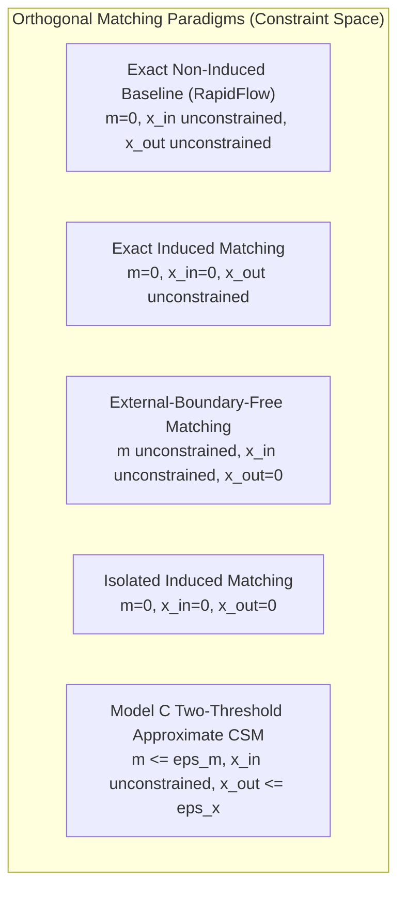
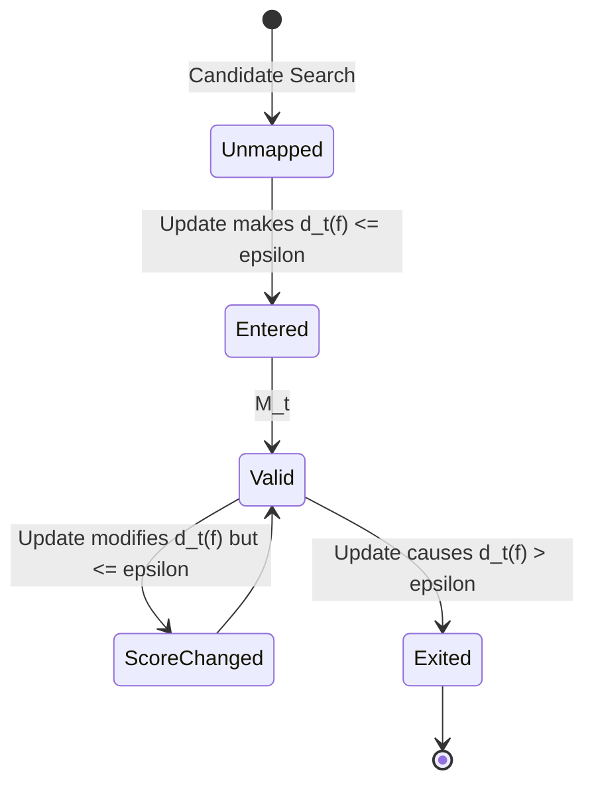

# APX-01: Approximate Continuous Subgraph Matching (CSM) — Problem Definition & Formal Semantics

- **Document Version:** `1.0.0-PROPOSAL`
- **Gate:** Gate A0 (APX-01 — Semantics & Threshold Selection Protocol)
- **Status:** DRAFT WORKING SPECIFICATION / FOR PEER & ADVISOR REVIEW
- **Parent Issue:** [#12 — [APX-01] Gate A0: Approximate CSM Semantics & Threshold Selection Protocol](https://github.com/iamqthanq/Seminar_RapidFlow/issues/12)
- **Repository Target:** `iamqthanq/Seminar_RapidFlow` (Integration base: `QuangThang`)
- **Author:** Senior Graph Algorithms Researcher & Research Software Engineer

---

## 1. Executive Research Context

Following advisor discussions during Week 9, the Seminar RapidFlow research direction is expanding from **Exact Continuous Subgraph Matching (CSM)** to **Approximate Continuous Subgraph Matching (Approximate CSM)** over streaming labeled graphs (NetFlow).

The advisor's stated motivation focuses on:
1. Detecting structural patterns in dynamic network streams that are "near-matches" to a query pattern $Q$ under a bounded tolerance for structural imperfections;
2. Accommodating realistic structural noise such as extraneous connections (e.g. extra peripheral tails or hub branches attached to star centers);
3. Investigating query graphs larger than 6 vertices ($|V_Q| > 6$);
4. Providing explicit embedding retrieval (concrete vertex mapping instances) rather than aggregate count scalars.

However, the advisor **did not provide a formal mathematical deviation function or numeric threshold**. In scientific graph pattern matching, an ambiguous definition of "approximate" introduces fatal methodological flaws:
- Merely adding an extraneous connection filter to exact non-induced matchings yields a strict *subset* of exact embeddings, failing to find genuinely inexact embeddings with missing edges.
- Unconstrained missing edges on tree queries can cause mapped vertex sets to lose topological connectivity.
- Penalizing all incident external edges indiscriminately will disqualify every embedding that touches high-degree network hubs.

This document formally establishes the mathematical foundations, matching constraints, lifecycle dynamics, and output contracts for Approximate CSM to govern all subsequent implementation gates (APX-02 through APX-05).

---

## 2. Formal Mathematical Foundations & Graph Model

### 2.1. Basic Definitions and Notation

Let $\Sigma_V$ and $\Sigma_E$ denote finite sets of vertex labels and edge labels, respectively.

- **Query Graph:**
  A fixed, connected, undirected, labeled simple graph:
  $$Q = (V_Q, E_Q, \ell_Q)$$
  where $V_Q = \{u_1, u_2, \dots, u_k\}$ is the vertex set ($|V_Q| = k$), $E_Q \subseteq \{\{u, v\} \mid u, v \in V_Q, u \ne v\}$ is the undirected edge set, and $\ell_Q: V_Q \cup E_Q \to \Sigma_V \cup \Sigma_E$ is the labeling function assigning vertex labels $\ell_Q(u) \in \Sigma_V$ and edge labels $\ell_Q(e) \in \Sigma_E$.

- **Dynamic Data Graph:**
  A dynamic, undirected, labeled simple graph at discrete time step $t \in \mathbb{N}$:
  $$G_t = (V_t, E_t, \ell_t)$$
  evolving from an initial snapshot $G_0$ via a sequence of discrete edge update operations:
  $$\mathcal{S} = (\Delta e_1, \Delta e_2, \dots, \Delta e_t, \dots)$$
  where each update is a tuple $\Delta e_t = (op_t, u_t, v_t, l_t)$ with $op_t \in \{+, -\}$, endpoints $u_t, v_t \in V_t$, and edge label $l_t \in \Sigma_E$.
  - Edge Insertion ($op = +$): $E_t = E_{t-1} \cup \{\{u_t, v_t\}\}$ with $\ell_t(\{u_t, v_t\}) = l_t$.
  - Edge Deletion ($op = -$): $E_t = E_{t-1} \setminus \{\{u_t, v_t\}\}$.

- **Candidate Vertex Mapping:**
  A function mapping query vertices to data vertices at time step $t$:
  $$f: V_Q \to V_t$$
  The image of the mapping is denoted by $S_f = f(V_Q) = \{f(u) \mid u \in V_Q\} \subseteq V_t$.

- **Induced Subgraph on Mapping Image:**
  The subgraph of $G_t$ induced by the mapped vertices $S_f$ is denoted:
  $$G_t[S_f] = (S_f, E_t[S_f])$$
  where $E_t[S_f] = \{\{x, y\} \in E_t \mid x, y \in S_f\}$.

---

## 3. Structural Constraints & Matching Semantics

### 3.1. Injective Vertex Constraint
In all variations of CSM investigated in this research, candidate mappings must strictly satisfy the **injectivity axiom**:

$$\forall u, v \in V_Q, \quad u \ne v \implies f(u) \ne f(v)$$

- **Rationale:** Preserves distinct entity identity. Each query vertex must correspond to a distinct data vertex. Homomorphic mappings (where distinct query vertices collapse onto the same data vertex) are explicitly excluded to maintain consistency with the RapidFlow algorithmic baseline.

### 3.2. Hard Vertex Label Constraint
Vertex labels are treated as **hard filtering invariants**:

$$\forall u \in V_Q, \quad \ell_t(f(u)) = \ell_Q(u)$$

- **Rationale:** In IP network telemetry (NetFlow), vertex labels represent distinct entity types (used in hypothetical domain illustrations such as host types, autonomous systems, router interfaces). Relaxing vertex labels introduces categorical semantics that obscure structural evaluation. Any mapping violating vertex labels is rejected immediately with cost $\infty$.

### 3.3. Rigorous Differentiation: Exact Non-Induced vs. Induced vs. Approximate

A frequent source of confusion in graph querying literature is conflating non-induced matching, induced matching, and approximate matching. Rather than a linear hierarchy or simple subset chain, these paradigms represent distinct configurations along three independent structural constraint axes:
1. **Missing Query Edges ($m_t(f)$):** Tolerance for absent or mismatched query edges ($\varepsilon_m$).
2. **Internal Extra Chords ($x_{\mathrm{in},t}(f)$):** Tolerance for extra edges strictly inside $S_f$ ($\varepsilon_{\mathrm{in}}$).
3. **External Boundary Cut ($x_{\mathrm{out},t}(f)$):** Tolerance for cut edges leaving $S_f$ to $V_t \setminus S_f$ ($\varepsilon_x$).

> [!IMPORTANT]
> **Absence of Universal Subset / Containment Ordering between Exact and Model C:**
> There is **no universal subset or superset relationship** between Exact Non-Induced matching ($\mathcal{M}_t^{\mathrm{exact}}$) and Model C Approximate matching ($\mathcal{M}_t^{(\varepsilon_m, \varepsilon_x)}$) when $\varepsilon_m \ge 1$ and $\varepsilon_x < \infty$:
> - When $\varepsilon_m \ge 1$, Model C **relaxes** edge requirements, admitting inexact mappings where query edges are missing ($m > 0$). Such mappings do not belong to $\mathcal{M}_t^{\mathrm{exact}}$.
> - When $\varepsilon_x < \infty$, Model C **restricts** external cut edges, disqualifying exact mappings whose boundary degree exceeds $\varepsilon_x$. Such mappings belong to $\mathcal{M}_t^{\mathrm{exact}}$ but are excluded from $\mathcal{M}_t^{(\varepsilon_m, \varepsilon_x)}$.
> - Consequently, $\mathcal{M}_t^{(\varepsilon_m, \varepsilon_x)}$ and $\mathcal{M}_t^{\mathrm{exact}}$ generally have non-empty symmetric differences ($A \setminus B \ne \emptyset$ and $B \setminus A \ne \emptyset$).

1. **Exact Non-Induced Subgraph Isomorphism (RapidFlow Baseline):**
   $$\forall \{u, v\} \in E_Q, \quad \{f(u), f(v)\} \in E_t \quad \land \quad \ell_t(\{f(u), f(v)\}) = \ell_Q(\{u, v\})$$
   - Characterized by $m(f) = 0$.
   - Extra edges among vertices in $S_f$ ($x_{\mathrm{in}} \ge 0$) are unpenalized.
   - Extra edges connecting $S_f$ to the rest of $G_t$ ($x_{\mathrm{out}} \ge 0$) are unpenalized.

2. **Exact Induced Subgraph Isomorphism:**
   $$\forall \{u, v\} \subset V_Q, \quad \{u, v\} \in E_Q \iff \{f(u), f(v)\} \in E_t \quad \land \quad \ell_t(\{f(u), f(v)\}) = \ell_Q(\{u, v\})$$
   - Characterized by $m(f) = 0 \land x_{\mathrm{in}}(f) = 0$.
   - Absolutely no extra internal edges within $S_f$ are permitted ($x_{\mathrm{in}} = 0$). External edges outside $S_f$ ($x_{\mathrm{out}} \ge 0$) are unpenalized.

3. **External-Boundary-Free Matching:**
   $$x_{\mathrm{out}}(f) = 0$$
   - Strictly forbids cut edges between $S_f$ and $V_t \setminus S_f$.
   - Does **not** constrain internal edges: $x_{\mathrm{in}}(f) \ge 0$ is unpenalized.

4. **Isolated Induced Matching:**
   $$m(f) = 0 \quad \land \quad x_{\mathrm{in}}(f) = 0 \quad \land \quad x_{\mathrm{out}}(f) = 0$$
   - The mapped subgraph $G_t[S_f]$ is an isolated connected component of $G_t$ exactly isomorphic to $Q$.

> [!WARNING]
> **Refutation of Induced Matching Equivalence for Model C with $\varepsilon_x = 0$:**
> Setting $\varepsilon_m = 0 \land \varepsilon_x = 0$ in Model C ($m_t(f) \le \varepsilon_m \land x_{\mathrm{out},t}(f) \le \varepsilon_x$) does **NOT** entail induced subgraph matching.
> **Counterexample:** Let $Q = C_4$ (4-cycle with $|E_Q| = 4$) and let $G_t = K_4$ (complete graph on 4 vertices with $|E_t| = 6$). Let $f$ map $V_Q$ bijectively onto the 4 vertices of $K_4$.
> - All 4 cycle edges exist with matching labels $\implies m(f) = 0 \le \varepsilon_m = 0$.
> - All vertices of $G_t$ belong to $S_f$, so no edges leave $S_f \implies x_{\mathrm{out}}(f) = 0 \le \varepsilon_x = 0$.
> - Thus, Model C **ACCEPTS** $f$ under $\varepsilon_m = 0, \varepsilon_x = 0$.
> - However, $G_t[S_f]$ contains 2 extra internal chords ($x_{\mathrm{in}}(f) = 2 \ne 0$). Under Exact Induced Subgraph Matching, $f$ is **REJECTED**.
> - Therefore, Model C with $\varepsilon_x = 0$ guarantees external boundary isolation, not induced subgraph matching.

5. **Exact Subgraph with Clutter Threshold (Pseudo-Approximate):**
   $$\text{Exact Non-Induced}(f) \quad \land \quad x_{\mathrm{out},t}(f) \le \varepsilon_x$$
   - All query edges must be present ($m(f) = 0$). Only external boundary edges are filtered.
   - **Crucial Limitation:** This produces a subset of exact matches ($\mathcal{M}_t \subseteq \mathcal{M}_t^{\mathrm{exact}}$); if all exact matches satisfy the clutter threshold, the subset is non-strict ($\mathcal{M}_t = \mathcal{M}_t^{\mathrm{exact}}$). It cannot discover patterns where an expected communication link is missing or dropped.

6. **True Approximate Subgraph Matching (APX Research Target):**
   A mapping $f$ is accepted if its structural deviation satisfies Model C:
   $$\mathcal{M}_t^{(\varepsilon_m, \varepsilon_x)} = \{f: V_Q \to V_t \mid f \text{ is injective}, \text{labels satisfied}, m_t(f) \le \varepsilon_m \land x_{\mathrm{out},t}(f) \le \varepsilon_x\}$$
   When $\varepsilon_m \ge 1$, the model **can admit** genuinely inexact mappings ($\mathcal{M}_t^{(\varepsilon_m, \varepsilon_x)}$ is not guaranteed to be a subset of $\mathcal{M}_t^{\mathrm{exact}}$ if near-matches exist in the data graph).

### 3.4. Disambiguation: Network Motifs vs. Approximate CSM
The term "network motif" (introduced by Milo et al., Science 2002) refers to a **statistical property** of network topology: subgraphs that appear at a significantly higher frequency in an empirical graph than in randomized null models (preserving degree sequence).
- Network motif discovery requires statistical null-model hypothesis testing (Z-scores, p-values).
- In contrast, Continuous Subgraph Matching is a **deterministic graph querying problem**: finding embeddings of a designated pattern $Q$.
- Approximate CSM relaxes structural congruence; it does NOT calculate statistical network significance.

---

## 4. Formal Definition of Candidate Deviation Measures

To explore the advisor's intent rigorously, we formulate four structural deviation components:

### 4.1. Missing-Edge Deviation ($m_t(f)$)
The count of edges required by query $Q$ that fail to appear with matching labels between the corresponding mapped data vertices.

To ensure the label predicate is well-defined and does not dereference a label on an absent edge, we define the boolean satisfaction predicate $\text{required\_edge\_matches}(u, v, f, t)$:

$$\text{required\_edge\_matches}(u, v, f, t) \iff \Big(\{f(u), f(v)\} \in E_t \;\land\; \ell_t(\{f(u), f(v)\}) = \ell_Q(\{u, v\})\Big)$$

The missing-edge deviation is then formally evaluated as:

$$m_t(f) = \sum_{\{u, v\} \in E_Q} \mathbf{1}\left[\neg \text{required\_edge\_matches}(u, v, f, t)\right]$$

- **Domain:** $m_t(f) \in \{0, 1, \dots, |E_Q|\}$.
- **Semantics:** $\varepsilon_m = 0 \implies$ no missing edges (exact edge presence). $\varepsilon_m = 1 \implies$ allows at most 1 missing query edge.
- **Edge Label Mismatch Convention:** If an edge $\{f(u), f(v)\} \in E_t$ exists between two mapped vertices $u, v \in V_Q$ but has $\ell_t(\{f(u), f(v)\}) \ne \ell_Q(\{u, v\})$, it increments $m_t(f)$ by 1. Because both endpoints lie within $S_f$, this is an internal structural violation; such internal mismatches NEVER contribute to external boundary clutter $x_{\mathrm{out},t}(f)$.
- **Topological Risk (Graph Disconnection):** If $Q$ is a tree or cycle, setting $m_t(f) \ge 1$ can cause the mapped vertex set $S_f$ to become disconnected in $G_t$. A connectivity constraint can be added as an explicit parameter (Section 4.5).

### 4.2. Internal Extra-Edge Deviation ($x_{\mathrm{in},t}(f)$)
The count of spurious edges in $G_t$ present between mapped vertices that do not exist in the query graph $Q$:

$$x_{\mathrm{in},t}(f) = \left|\left\{\{u, v\} \subset V_Q \mid \{u, v\} \notin E_Q \;\land\; \{f(u), f(v)\} \in E_t\right\}\right|$$

- **Domain:** $x_{\mathrm{in},t}(f) \in \left\{0, 1, \dots, \binom{k}{2} - |E_Q|\right\}$.
- **Semantics:** Measures deviation from an *induced* subgraph. If $Q$ is a path $P_4$ and $G_t[S_f]$ contains a cross-edge forming a chordal cycle, $x_{\mathrm{in}} = 1$.
- **Limitation:** $x_{\mathrm{in}}$ is completely blind to extraneous branches or hub edges that connect to data vertices outside $S_f$.

### 4.3. External Extra-Incident Deviation ($x_{\mathrm{out},t}(f)$) [Team-Proposed]
The count of edges in $G_t$ with one endpoint inside the mapped vertex set $S_f$ and the other endpoint outside $S_f$:

$$x_{\mathrm{out},t}(f) = \left|\left\{\{a, b\} \in E_t \mid a \in S_f \;\land\; b \in V_t \setminus S_f\right\}\right| = \sum_{a \in S_f} \deg_{G_t}(a) - 2 \cdot |E_t[S_f]|$$

- **Domain:** $x_{\mathrm{out},t}(f) \in \mathbb{N}_0$.
- **Strict Boundary Scope:** By mathematical definition, $x_{\mathrm{out},t}(f)$ strictly counts cut edges crossing the boundary between $S_f$ and $V_t \setminus S_f$. Any edge where both endpoints belong to $S_f$ is an internal edge and can never increment $x_{\mathrm{out},t}(f)$, regardless of whether its label matches or mismatches.
- **Semantics:** Directly operationalizes the advisor's example: if $Q$ is a star with center $c$ and leaves $l_1, l_2$, an extra tail connected to $f(c)$ in $G_t$ adds exactly 1 to $x_{\mathrm{out}}$.
- **Vulnerability on High-Degree Hubs:** In NetFlow, hubs reach degrees up to 49,014. If an internal query vertex binds to a hub, $x_{\mathrm{out},t}(f)$ can exceed $30{,}000$, rejecting the embedding unless $\varepsilon_x$ is configured with an enormous threshold.

### 4.4. Normalized External Structural Deviation ($x_{\mathrm{norm},t}(f)$)
To explore rescaling boundary clutter relative to query size:

$$x_{\mathrm{norm},t}(f) = \frac{x_{\mathrm{out},t}(f)}{2|E_Q| + x_{\mathrm{out},t}(f)} \in [0, 1)$$

- **Properties & Clarifications:**
  - The denominator $2|E_Q| + x_{\mathrm{out},t}(f)$ is a **query-size-anchored heuristic scale**, not the actual total incident volume of $S_f$ in general. (The actual total volume of edges incident to $S_f$ is $\sum_{v \in S_f} \deg_{G_t}(v) = 2|E(G_t[S_f])| + x_{\mathrm{out},t}(f)$, which deviates from $2|E_Q| + x_{\mathrm{out}}$ whenever $m > 0$ or $x_{\mathrm{in}} > 0$).
  - $x_{\mathrm{norm}}$ is an exploratory bounded rescaling into $[0, 1)$ for ranking experiments. It is **NOT** proposed as a formal metric space distance, and no claims of metric properties (such as triangle inequality) are asserted without a formally defined metric space.

### 4.5. Connectedness Constraint Options
When $m_t(f) > 0$, the mapped graph $G_t[S_f]$ can decompose into disconnected components. We define the boolean topological connectivity predicate $\mathcal{C}(f)$:

$$\mathcal{C}(f) \iff G_t[S_f] \text{ is a topologically connected graph } (\text{components}(G_t[S_f]) == 1)$$

The framework defines two explicit modes for evaluating connectivity:
- **Option C1 (Strict Connectedness Mode):** Require $\mathcal{C}(f) == \text{true}$ ($\text{components}(G_t[S_f]) = 1$). Note that connectivity is evaluated on the topological subgraph $G_t[S_f]$ induced by $S_f$ in data graph $G_t$ (edges present in $G_t$ between mapped vertices provide topological connectivity, regardless of whether their edge labels match query labels). Under strict mode, any mapping where missing edges produce isolated vertices or disconnected fragments (such as Case 02 and Case 03 in the microcase catalog) is strictly **REJECTED**, even if $m_t(f) \le \varepsilon_m \land x_{\mathrm{out},t}(f) \le \varepsilon_x$.
- **Option C2 (Relaxed Connectedness Mode):** Connectivity is **not required / not enforced** ($\mathcal{C}(f) \iff \text{true}$ or $\text{components}(G_t[S_f]) \le c_{\max}$). Crucially, "relaxed" means connectivity is unconstrained; it does **NOT** require mappings to be disconnected. Both connected mappings and disconnected mappings are accepted if they satisfy $m_t(f) \le \varepsilon_m \land x_{\mathrm{out},t}(f) \le \varepsilon_x$.
- **Unapproved Alternate (Label-Preserving Connectivity):** Requiring connectivity strictly via edges that also satisfy query edge labels ($\mathcal{C}_{\mathrm{label}}(f)$) is an unapproved alternate model that would alter semantic acceptance. Under Gate A0 frozen semantics, $\mathcal{C}(f)$ strictly denotes topological connectivity of $G_t[S_f]$.

---

## 5. Composite Threshold Models & Acceptance Criteria

Rather than blending heterogeneous quantities ($m$ and $x$) into an arbitrary weighted linear sum $\alpha m + \beta x$ (which obscures physical units), we prioritize the **Two-Threshold Decoupled Model**:

### The Decoupled Model $\mathcal{M}_t^{(\varepsilon_m, \varepsilon_x)}$

$$f \in \mathcal{M}_t^{(\varepsilon_m, \varepsilon_x)} \iff \begin{cases}
f \text{ is injective on } V_Q \\
\forall u \in V_Q, \ell_t(f(u)) = \ell_Q(u) \\
m_t(f) \le \varepsilon_m \\
x_{\mathrm{out},t}(f) \le \varepsilon_x \\
\mathcal{C}(f) == \text{true} \quad (\text{if strict connectivity is active})
\end{cases}$$

- **Parameter Space:** $\varepsilon_m \in \{0, 1, 2\}$, $\varepsilon_x \in \{0, 1, 2, 5, 10, 30, \infty\}$.
- **Exact Recovery:** When $\varepsilon_m = 0$ and $\varepsilon_x = \infty$, the mathematical set of accepted ordered mappings $\mathcal{M}_t^{(0, \infty)}$ is identical to the exact non-induced subgraph isomorphism set $\mathcal{M}_{\mathrm{exact}}(Q, G_t)$. Note that in RapidFlow's exact streaming engine (`streaming_engine.cpp:119–143,157–181`), candidate search is executed on a reduced query anchored at the update edge, and the local count is multiplied by a per-query-edge orbit multiplier (`automorphism_size` from `om_.get_automorphism_meta()`) to accumulate matches triggered by each stream update. This stream event accumulator is distinct from enumerating the full set of explicit ordered vertex mappings at a static snapshot $\mathcal{M}_t$.

---

## 6. Dynamic Streaming Lifecycle Semantics

In a continuous streaming environment, the set of accepted embeddings evolves dynamically after each edge update $\Delta e_t$:

### 6.1. Dynamic Delta Partitions
For any threshold tuple $\boldsymbol{\varepsilon} = (\varepsilon_m, \varepsilon_x)$:
1. **$\text{ENTERED}_t$:** Embeddings that were invalid at $t-1$ but become valid at $t$:
   $$\text{ENTERED}_t = \mathcal{M}_t^{\boldsymbol{\varepsilon}} \setminus \mathcal{M}_{t-1}^{\boldsymbol{\varepsilon}}$$
2. **$\text{EXITED}_t$:** Embeddings that were valid at $t-1$ but become invalid at $t$:
   $$\text{EXITED}_t = \mathcal{M}_{t-1}^{\boldsymbol{\varepsilon}} \setminus \mathcal{M}_t^{\boldsymbol{\varepsilon}}$$
3. **$\text{SCORE\_CHANGED}_t$:** Embeddings that remain valid across both snapshots, but whose deviation score shifted:
   $$\text{SCORE\_CHANGED}_t = \left\{f \in \mathcal{M}_t^{\boldsymbol{\varepsilon}} \cap \mathcal{M}_{t-1}^{\boldsymbol{\varepsilon}} \;\middle|\; (m_t(f), x_{\mathrm{out},t}(f)) \ne (m_{t-1}(f), x_{\mathrm{out},t-1}(f))\right\}$$

### 6.2. Non-Local Invalidation Hazard
> [!WARNING]
> **Critical Difference from Exact CSM:**
> In exact non-induced CSM, an update edge $\Delta e_t = \{a, b\}$ can only affect embeddings $f$ where $\{a, b\} \subseteq S_f$.
> Under Approximate CSM with external boundary penalty $x_{\mathrm{out}}$, if $a \in S_f$ and $b \notin S_f$, an edge insertion $\{a, b\}$ strictly increases $x_{\mathrm{out}}$ by 1.
> If $x_{\mathrm{out},t-1}(f) = \varepsilon_x$, this insertion immediately causes $f \in \text{EXITED}_t$, **even though the updated edge is completely outside the mapped pattern!**
> Consequently, indexing and search structures cannot assume that only edges internal to the query activate updates.

---

## 7. Automorphism Conventions & Output Modes

### 7.1. Labeled Mappings vs. Automorphism Equivalence vs. Unlabeled Occurrences

To eliminate ambiguity across research milestones, we formalize three distinct mathematical entities:

1. **Ordered Injective Mapping:**
   A sequence of mapped data vertex IDs preserving query vertex coordinate ordering:
   $$f = (f(u_1), f(u_2), \dots, f(u_k)) \in V_t^k \quad \text{such that} \quad f(u_i) \ne f(u_j) \text{ for } i \ne j$$
2. **Automorphism Equivalence Class:**
   Two mappings $f_1, f_2$ belong to the same equivalence class ($f_1 \sim f_2$) if there exists an edge- and label-preserving query automorphism $\pi \in \text{Aut}(Q)$ such that:
   $$f_2 = f_1 \circ \pi$$
   The equivalence class is denoted $[f] = \{ f \circ \pi \mid \pi \in \text{Aut}(Q) \}$.
3. **Vertex-Set Occurrence:**
   The un-ordered set of mapped data vertices in $G_t$:
   $$S_f = f(V_Q) = \{f(u_1), \dots, f(u_k)\} \subseteq V_t$$

> [!NOTE]
> **Disambiguation Example ($Q = P_4$ on $G = C_4$):**
> Let query $Q$ be a 4-vertex path $P_4 = (u_1 - u_2 - u_3 - u_4)$ and data graph $G$ be a 4-vertex cycle $C_4 = (v_1 - v_2 - v_3 - v_4 - v_1)$.
> - **Total Ordered Mappings ($f$):** Exactly $8$ distinct injective ordered sequences (each of the 4 starting vertices, traversing in 2 directions).
> - **Query Automorphisms ($|\text{Aut}(P_4)|$):** Exactly $2$ (identity and path reflection).
> - **Automorphism Classes ($[f]$):** $8 / |\text{Aut}(P_4)| = 8 / 2 = \mathbf{4}$ distinct classes (corresponding to the 4 distinct edges omitted from the cycle).
> - **Vertex-Set Occurrences ($S_f$):** Exactly $\mathbf{1}$ unique vertex set $\{v_1, v_2, v_3, v_4\}$.
>
> **Research Standard:** In APX-01 through APX-05, the canonical matching entity is the **concrete ordered injective mapping** $f = (f(u_1), \dots, f(u_k))$. Aggregated summaries may report count of unique occurrences or automorphism classes, but the algorithm contracts must produce concrete mappings.

### 7.2. Concrete Output Modes

| Output Mode | Operational Contract | Completion Guarantee | Performance Trade-off |
| :--- | :--- | :--- | :--- |
| `FULL_ENUMERATION` | Returns the complete set $\mathcal{M}_t^{\boldsymbol{\varepsilon}}$ of concrete ordered mappings $f = (f(u_1), \dots, f(u_k))$ along with deviation score tuple $(m_t(f), x_{\mathrm{out},t}(f))$. Required for the APX-02 independent reference oracle to track full snapshots and lifecycle deltas ($\text{ENTERED}_t, \text{EXITED}_t, \text{SCORE\_CHANGED}_t$). | Complete ($\text{Recall} = 1.0$) | High memory and serialization latency on large match sets. |
| `COUNT_ONLY` | Returns the integer scalar $|\mathcal{M}_t^{\boldsymbol{\varepsilon}}|$ representing total valid mappings at snapshot $t$. | Exact count only | Fast execution; does not produce concrete embeddings. |
| `TOP_K` | Returns $K$ mappings minimizing deviation score under a pre-approved ranking policy. | Optimal within $K$ under ranking policy | **Status: EXPLORATORY / PENDING RANKING POLICY APPROVAL.** Requires defining a deterministic tie-breaking / scalarization rule (e.g. lexicographic $\langle m, x_{\mathrm{out}}\rangle$ vs $\langle x_{\mathrm{out}}, m\rangle$). Not implemented in APX-01. |
| `FIRST_K` (Witnesses) | Returns the first $K$ valid mappings discovered during search traversal. Note: $K = 1000$ in configuration drafts is strictly an **exploratory pilot default** for test harnesses, not an approved production truncation. | Non-optimal; witness only | Fast response; must output explicit `is_complete` boolean flag indicating whether the entire candidate space was exhausted. |

---

## 8. Summary of Preregistered Semantic Rules

1. **Undirected Simple Graphs:** All inputs are simple undirected graphs without self-loops or multi-edges.
2. **Injective Vertex Mapping:** Strictly enforced ($f(u) \ne f(v)$ for $u \ne v$).
3. **Exact Vertex Labels:** Strictly enforced ($\ell_t(f(u)) = \ell_Q(u)$).
4. **Decoupled Two-Threshold Model:** Primary model for investigation: $m_t(f) \le \varepsilon_m \land x_{\mathrm{out},t}(f) \le \varepsilon_x$.
5. **Connectivity Default:** Mapped subgraphs must satisfy $\mathcal{C}(f) == \text{true}$ to preserve structural coherence.
6. **Output Contract:** Concrete labeled mappings $f = (f(u_1), \dots, f(u_k))$ with associated score tuple $(m, x)$.
