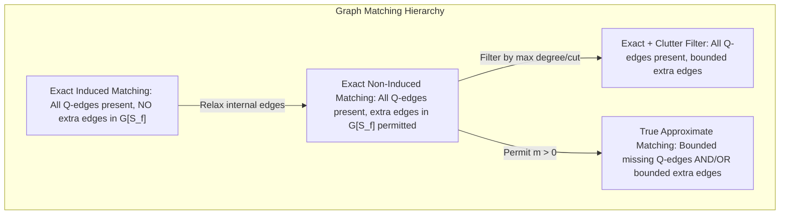
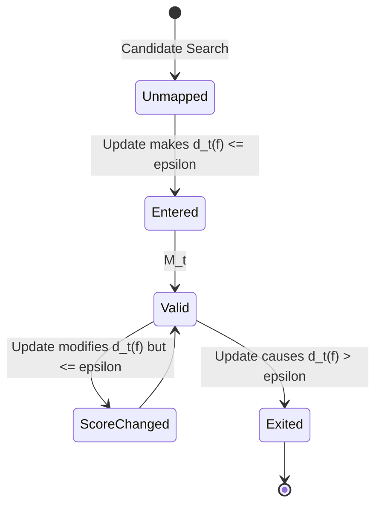

# APX-01: Approximate Continuous Subgraph Matching (CSM) — Problem Definition & Formal Semantics

- **Document Version:** `1.0.0-PROPOSAL`
- **Gate:** Gate A0 (APX-01 — Semantics & Threshold Selection Protocol)
- **Status:** DRAFT WORKING SPECIFICATION / FOR PEER & ADVISOR REVIEW
- **Parent Issue:** [#12 — [APX-01] Gate A0: Approximate CSM Semantics & Threshold Selection Protocol](https://github.com/iamqthanq/Seminar_RapidFlow/issues/12)
- **Repository Target:** `iamqthanq/Seminar_RapidFlow` (Integration base: `QuangThang`)
- **Author:** Senior Graph Algorithms Researcher & Research Software Engineer

---

## 1. Executive Research Context

Following advisor discussions during Week 9, the Seminar RapidFlow research direction is expanding from **Exact Continuous Subgraph Matching (CSM)** to **Approximate Continuous Subgraph Matching (Approximate CSM)** over streaming labeled graphs (NetFlow).

The advisor's stated motivation focuses on:
1. Detecting structural patterns in dynamic network streams that are "near-matches" to a query pattern $Q$ under a bounded tolerance for structural imperfections;
2. Accommodating realistic structural noise such as extraneous connections (e.g. extra peripheral tails or hub branches attached to star centers);
3. Investigating query graphs larger than 6 vertices ($|V_Q| > 6$);
4. Providing explicit embedding retrieval (concrete vertex mapping instances) rather than aggregate count scalars.

However, the advisor **did not provide a formal mathematical deviation function or numeric threshold**. In scientific graph pattern matching, an ambiguous definition of "approximate" introduces fatal methodological flaws:
- Merely adding an extraneous connection filter to exact non-induced matchings yields a strict *subset* of exact embeddings, failing to find genuinely inexact embeddings with missing edges.
- Unconstrained missing edges on tree queries can cause mapped vertex sets to lose topological connectivity.
- Penalizing all incident external edges indiscriminately will disqualify every embedding that touches high-degree network hubs.

This document formally establishes the mathematical foundations, matching constraints, lifecycle dynamics, and output contracts for Approximate CSM to govern all subsequent implementation gates (APX-02 through APX-05).

---

## 2. Formal Mathematical Foundations & Graph Model

### 2.1. Basic Definitions and Notation

Let $\Sigma_V$ and $\Sigma_E$ denote finite sets of vertex labels and edge labels, respectively.

- **Query Graph:**
  A fixed, connected, undirected, labeled simple graph:
  $$Q = (V_Q, E_Q, \ell_Q)$$
  where $V_Q = \{u_1, u_2, \dots, u_k\}$ is the vertex set ($|V_Q| = k$), $E_Q \subseteq \{\{u, v\} \mid u, v \in V_Q, u \ne v\}$ is the undirected edge set, and $\ell_Q: V_Q \cup E_Q \to \Sigma_V \cup \Sigma_E$ is the labeling function assigning vertex labels $\ell_Q(u) \in \Sigma_V$ and edge labels $\ell_Q(e) \in \Sigma_E$.

- **Dynamic Data Graph:**
  A dynamic, undirected, labeled simple graph at discrete time step $t \in \mathbb{N}$:
  $$G_t = (V_t, E_t, \ell_t)$$
  evolving from an initial snapshot $G_0$ via a sequence of discrete edge update operations:
  $$\mathcal{S} = (\Delta e_1, \Delta e_2, \dots, \Delta e_t, \dots)$$
  where each update is a tuple $\Delta e_t = (op_t, u_t, v_t, l_t)$ with $op_t \in \{+, -\}$, endpoints $u_t, v_t \in V_t$, and edge label $l_t \in \Sigma_E$.
  - Edge Insertion ($op = +$): $E_t = E_{t-1} \cup \{\{u_t, v_t\}\}$ with $\ell_t(\{u_t, v_t\}) = l_t$.
  - Edge Deletion ($op = -$): $E_t = E_{t-1} \setminus \{\{u_t, v_t\}\}$.

- **Candidate Vertex Mapping:**
  A function mapping query vertices to data vertices at time step $t$:
  $$f: V_Q \to V_t$$
  The image of the mapping is denoted by $S_f = f(V_Q) = \{f(u) \mid u \in V_Q\} \subseteq V_t$.

- **Induced Subgraph on Mapping Image:**
  The subgraph of $G_t$ induced by the mapped vertices $S_f$ is denoted:
  $$G_t[S_f] = (S_f, E_t[S_f])$$
  where $E_t[S_f] = \{\{x, y\} \in E_t \mid x, y \in S_f\}$.

---

## 3. Structural Constraints & Matching Semantics

### 3.1. Injective Vertex Constraint
In all variations of CSM investigated in this research, candidate mappings must strictly satisfy the **injectivity axiom**:

$$\forall u, v \in V_Q, \quad u \ne v \implies f(u) \ne f(v)$$

- **Rationale:** Preserves distinct entity identity. Each query vertex must correspond to a distinct data vertex. Homomorphic mappings (where distinct query vertices collapse onto the same data vertex) are explicitly excluded to maintain consistency with the RapidFlow algorithmic baseline.

### 3.2. Hard Vertex Label Constraint
Vertex labels are treated as **hard filtering invariants**:

$$\forall u \in V_Q, \quad \ell_t(f(u)) = \ell_Q(u)$$

- **Rationale:** In IP network telemetry (NetFlow), vertex labels represent distinct entity types (e.g. host types, autonomous systems, router interfaces). Relaxing vertex labels introduces categorical semantics that obscure structural evaluation. Any mapping violating vertex labels is rejected immediately with cost $\infty$.

### 3.3. Rigorous Differentiation: Exact Non-Induced vs. Induced vs. Approximate

A frequent source of confusion in literature is conflating non-induced matching with approximate matching:

1. **Exact Non-Induced Subgraph Isomorphism (RapidFlow Baseline):**
   $$\forall \{u, v\} \in E_Q, \quad \{f(u), f(v)\} \in E_t \quad \land \quad \ell_t(\{f(u), f(v)\}) = \ell_Q(\{u, v\})$$
   - Extra edges among vertices in $S_f$ are unpenalized.
   - Extra edges connecting $S_f$ to the rest of $G_t$ are unpenalized.
2. **Exact Induced Subgraph Isomorphism:**
   $$\forall \{u, v\} \subset V_Q, \quad \{u, v\} \in E_Q \iff \{f(u), f(v)\} \in E_t \quad \land \quad \ell_t(\{f(u), f(v)\}) = \ell_Q(\{u, v\})$$
   - Absolutely no extra edges within $S_f$ are permitted. External edges outside $S_f$ are unpenalized.
3. **Exact Subgraph with Clutter Threshold (Pseudo-Approximate):**
   $$\text{Exact Non-Induced}(f) \quad \land \quad \text{Clutter}(f) \le \varepsilon_x$$
   - All query edges must be present ($m(f) = 0$). Only external or internal extra edges are filtered.
   - **Crucial Limitation:** This produces a strict subset of exact matches. It cannot discover patterns where an expected communication link is missing or dropped.
4. **True Approximate Subgraph Matching (APX Research Target):**
   A mapping $f$ is accepted if its structural deviation $d_t(f)$ satisfies a threshold $\varepsilon$:
   $$\mathcal{M}_t^\varepsilon = \{f: V_Q \to V_t \mid f \text{ is injective}, \text{labels satisfied}, d_t(f) \le \varepsilon\}$$
   When $d_t(f)$ permits $m(f) > 0$, the accepted set $\mathcal{M}_t^\varepsilon$ contains non-exact mappings ($\mathcal{M}_t^\varepsilon \not\subseteq \mathcal{M}_t^{\text{exact}}$).

### 3.4. Disambiguation: Network Motifs vs. Approximate CSM
The term "network motif" (introduced by Milo et al., Science 2002) refers to a **statistical property** of network topology: subgraphs that appear at a significantly higher frequency in an empirical graph than in randomized null models (preserving degree sequence).
- Network motif discovery requires statistical null-model hypothesis testing (Z-scores, p-values).
- In contrast, Continuous Subgraph Matching is a **deterministic graph querying problem**: finding embeddings of a designated pattern $Q$.
- Approximate CSM relaxes structural congruence; it does NOT calculate statistical network significance.

---

## 4. Formal Definition of Candidate Deviation Measures

To explore the advisor's intent rigorously, we formulate four structural deviation components:

### 4.1. Missing-Edge Deviation ($m_t(f)$)
The count of edges required by query $Q$ that fail to appear with matching labels between the corresponding mapped data vertices:

$$m_t(f) = \sum_{\{u, v\} \in E_Q} \mathbf{1}\left[\{f(u), f(v)\} \notin E_t \;\lor\; \ell_t(\{f(u), f(v)\}) \ne \ell_Q(\{u, v\})\right]$$

- **Domain:** $m_t(f) \in \{0, 1, \dots, |E_Q|\}$.
- **Semantics:** $\varepsilon_m = 0 \implies$ no missing edges (exact edge presence). $\varepsilon_m = 1 \implies$ allows at most 1 missing query edge.
- **Topological Risk (Graph Disconnection):** If $Q$ is a tree or cycle, setting $m_t(f) \ge 1$ can cause the mapped vertex set $S_f$ to become disconnected in $G_t$. A connectivity constraint can be added as an explicit parameter (Section 4.5).

### 4.2. Internal Extra-Edge Deviation ($x_{\mathrm{in},t}(f)$)
The count of spurious edges in $G_t$ present between mapped vertices that do not exist in the query graph $Q$:

$$x_{\mathrm{in},t}(f) = \left|\left\{\{u, v\} \subset V_Q \mid \{u, v\} \notin E_Q \;\land\; \{f(u), f(v)\} \in E_t\right\}\right|$$

- **Domain:** $x_{\mathrm{in},t}(f) \in \left\{0, 1, \dots, \binom{k}{2} - |E_Q|\right\}$.
- **Semantics:** Measures deviation from an *induced* subgraph. If $Q$ is a path $P_4$ and $G_t[S_f]$ contains a cross-edge forming a chordal cycle, $x_{\mathrm{in}} = 1$.
- **Limitation:** $x_{\mathrm{in}}$ is completely blind to extraneous branches or hub edges that connect to data vertices outside $S_f$.

### 4.3. External Extra-Incident Deviation ($x_{\mathrm{out},t}(f)$) [Team-Proposed]
The count of edges in $G_t$ with one endpoint inside the mapped vertex set $S_f$ and the other endpoint outside $S_f$:

$$x_{\mathrm{out},t}(f) = \left|\left\{\{a, b\} \in E_t \mid a \in S_f \;\land\; b \in V_t \setminus S_f\right\}\right| = \sum_{a \in S_f} \deg_{G_t}(a) - 2 \cdot |E_t[S_f]|$$

- **Domain:** $x_{\mathrm{out},t}(f) \in \mathbb{N}_0$.
- **Semantics:** Directly operationalizes the advisor's example: if $Q$ is a star with center $c$ and leaves $l_1, l_2$, an extra tail connected to $f(c)$ in $G_t$ adds exactly 1 to $x_{\mathrm{out}}$.
- **Vulnerability on High-Degree Hubs:** In NetFlow, hubs reach degrees up to 49,014. If an internal query vertex binds to a hub, $x_{\mathrm{out},t}(f)$ can exceed $30{,}000$, rejecting the embedding unless $\varepsilon_x$ is configured with an enormous threshold.

### 4.4. Normalized External Structural Deviation ($x_{\mathrm{norm},t}(f)$)
To prevent absolute degree inflation from overwhelming larger queries, an exploratory normalized metric is defined:

$$x_{\mathrm{norm},t}(f) = \frac{x_{\mathrm{out},t}(f)}{2|E_Q| + x_{\mathrm{out},t}(f)} \in [0, 1)$$

- Measures the proportion of boundary edges relative to the total incident volume of the pattern.

### 4.5. Connectedness Constraint Options
When $m_t(f) > 0$, the mapped graph $G_t[S_f]$ can decompose into disconnected components. We define the boolean connectivity flag $\mathcal{C}(f)$:

$$\mathcal{C}(f) = \begin{cases} \text{true} & \text{if } G_t[S_f] \text{ is a connected graph} \\ \text{false} & \text{otherwise} \end{cases}$$

- **Option C1 (Strict Connectedness):** Require $\mathcal{C}(f) == \text{true}$. Rejects mappings where missing edges split the pattern into isolated vertices.
- **Option C2 (Relaxed Connectedness):** Permit disconnected components up to a maximum component count $c_{\max} \ge 2$.

---

## 5. Composite Threshold Models & Acceptance Criteria

Rather than blending heterogeneous quantities ($m$ and $x$) into an arbitrary weighted linear sum $\alpha m + \beta x$ (which obscures physical units), we prioritize the **Two-Threshold Decoupled Model**:

### The Decoupled Model $\mathcal{M}_t^{(\varepsilon_m, \varepsilon_x)}$

$$f \in \mathcal{M}_t^{(\varepsilon_m, \varepsilon_x)} \iff \begin{cases}
f \text{ is injective on } V_Q \\
\forall u \in V_Q, \ell_t(f(u)) = \ell_Q(u) \\
m_t(f) \le \varepsilon_m \\
x_{\mathrm{out},t}(f) \le \varepsilon_x \\
\mathcal{C}(f) == \text{true} \quad (\text{if strict connectivity is active})
\end{cases}$$

- **Parameter Space:** $\varepsilon_m \in \{0, 1, 2\}$, $\varepsilon_x \in \{0, 1, 2, 5, 10, 30, \infty\}$.
- **Exact Recovery:** When $\varepsilon_m = 0$ and $\varepsilon_x = \infty$, the model collapses exactly to RapidFlow's exact non-induced CSM semantics.

---

## 6. Dynamic Streaming Lifecycle Semantics

In a continuous streaming environment, the set of accepted embeddings evolves dynamically after each edge update $\Delta e_t$:

### 6.1. Dynamic Delta Partitions
For any threshold tuple $\boldsymbol{\varepsilon} = (\varepsilon_m, \varepsilon_x)$:
1. **$\text{ENTERED}_t$:** Embeddings that were invalid at $t-1$ but become valid at $t$:
   $$\text{ENTERED}_t = \mathcal{M}_t^{\boldsymbol{\varepsilon}} \setminus \mathcal{M}_{t-1}^{\boldsymbol{\varepsilon}}$$
2. **$\text{EXITED}_t$:** Embeddings that were valid at $t-1$ but become invalid at $t$:
   $$\text{EXITED}_t = \mathcal{M}_{t-1}^{\boldsymbol{\varepsilon}} \setminus \mathcal{M}_t^{\boldsymbol{\varepsilon}}$$
3. **$\text{SCORE\_CHANGED}_t$:** Embeddings that remain valid across both snapshots, but whose deviation score shifted:
   $$\text{SCORE\_CHANGED}_t = \left\{f \in \mathcal{M}_t^{\boldsymbol{\varepsilon}} \cap \mathcal{M}_{t-1}^{\boldsymbol{\varepsilon}} \;\middle|\; (m_t(f), x_{\mathrm{out},t}(f)) \ne (m_{t-1}(f), x_{\mathrm{out},t-1}(f))\right\}$$

### 6.2. Non-Local Invalidation Hazard
> [!WARNING]
> **Critical Difference from Exact CSM:**
> In exact non-induced CSM, an update edge $\Delta e_t = \{a, b\}$ can only affect embeddings $f$ where $\{a, b\} \subseteq S_f$.
> Under Approximate CSM with external boundary penalty $x_{\mathrm{out}}$, if $a \in S_f$ and $b \notin S_f$, an edge insertion $\{a, b\}$ strictly increases $x_{\mathrm{out}}$ by 1.
> If $x_{\mathrm{out},t-1}(f) = \varepsilon_x$, this insertion immediately causes $f \in \text{EXITED}_t$, **even though the updated edge is completely outside the mapped pattern!**
> Consequently, indexing and search structures cannot assume that only edges internal to the query activate updates.

---

## 7. Automorphism Conventions & Output Modes

### 7.1. Labeled Mappings vs. Unlabeled Occurrences
- **Labeled Mapping:** An ordered vector of data vertex IDs $f = (f(u_1), f(u_2), \dots, f(u_k))$. If query automorphism allows swapping two leaf vertices, the two distinct orderings are treated as distinct labeled mappings.
- **Unlabeled Occurrence:** The set of data vertices $S_f = \{f(u_1), \dots, f(u_k)\}$. Two mappings $f_1, f_2$ are automorphism-equivalent ($f_1 \sim f_2$) if they induce the same vertex set and edge mappings.
- **Research Standard:** In APX-01 through APX-04, the primary output representation is **concrete ordered labeled mappings** ($f: V_Q \to V_t$), ensuring direct correspondence with RapidFlow's internal order representations.

### 7.2. Concrete Output Modes
| Output Mode | Operational Contract | Completion Guarantee | Performance Trade-off |
| :--- | :--- | :--- | :--- |
| `FULL_ENUMERATION` | Returns the complete set $\mathcal{M}_t^{\boldsymbol{\varepsilon}}$ with concrete vertex IDs and deviation scores $(m, x)$. | Complete ($\text{Recall} = 1.0$) | High memory and serialization latency on large match sets. |
| `COUNT_ONLY` | Returns the integer scalar $|\mathcal{M}_t^{\boldsymbol{\varepsilon}}|$ representing total valid mappings. | Exact count only | Fast execution; does not produce concrete embeddings. |
| `TOP_K` | Returns $K$ mappings minimizing deviation score: $\arg\min_{f \in \mathcal{M}_t, |R|=K} d_t(f)$. | Optimal within $K$ | Requires priority queue / branch-and-bound pruning. |
| `FIRST_K` (Witnesses) | Returns the first $K$ valid mappings discovered during search traversal. | Non-optimal; witness only | Fast response; must output explicit `is_complete` boolean flag. |

---

## 8. Summary of Preregistered Semantic Rules

1. **Undirected Simple Graphs:** All inputs are simple undirected graphs without self-loops or multi-edges.
2. **Injective Vertex Mapping:** Strictly enforced ($f(u) \ne f(v)$ for $u \ne v$).
3. **Exact Vertex Labels:** Strictly enforced ($\ell_t(f(u)) = \ell_Q(u)$).
4. **Decoupled Two-Threshold Model:** Primary model for investigation: $m_t(f) \le \varepsilon_m \land x_{\mathrm{out},t}(f) \le \varepsilon_x$.
5. **Connectivity Default:** Mapped subgraphs must satisfy $\mathcal{C}(f) == \text{true}$ to preserve structural coherence.
6. **Output Contract:** Concrete labeled mappings $f = (f(u_1), \dots, f(u_k))$ with associated score tuple $(m, x)$.
