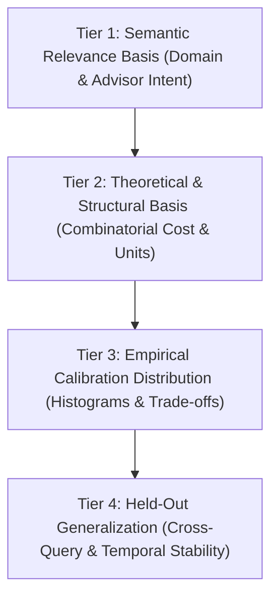
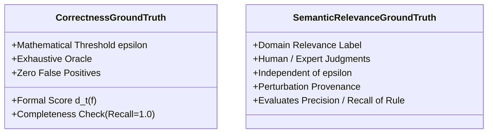

# APX-01: Threshold Selection Protocol — Calibration, Evidence & Validation

- **Document Version:** `1.0.0-PROPOSAL`
- **Gate:** Gate A0 (APX-01 — Semantics & Threshold Selection Protocol)
- **Status:** DRAFT WORKING SPECIFICATION / FOR PEER & ADVISOR REVIEW
- **Parent Issue:** [#12 — [APX-01] Gate A0: Approximate CSM Semantics & Threshold Selection Protocol](https://github.com/iamqthanq/Seminar_RapidFlow/issues/12)
- **Repository Target:** `iamqthanq/Seminar_RapidFlow` (Integration base: `QuangThang`)
- **Author:** Senior Graph Algorithms Researcher & Research Software Engineer

---

## 1. The Methodological Challenge of Threshold Selection

In approximate graph matching, proposing a threshold value $\varepsilon = 2$ without evidentiary grounding is unscientific. A reviewer or committee will inevitably ask:

> *"Why did you select $\varepsilon = 2$ rather than $\varepsilon = 1$ or $\varepsilon = 5$? What empirical, structural, or statistical evidence justifies this choice?"*

If $\varepsilon$ is set arbitrarily:
- Setting $\varepsilon$ too low collapses the query result into the exact matching set ($\mathcal{M}_t \approx \mathcal{M}_t^{\text{exact}}$), rendering the approximate matching machinery redundant.
- Setting $\varepsilon$ too high triggers combinatorial state explosion, returning millions of topologically meaningless mappings and exhausting system resources.
- On NetFlow, setting a small external degree threshold ($\varepsilon_x \le 2$) eliminates every embedding touching a network hub, creating an artificial runtime "speedup" that is merely an artifact of an empty result set.

This protocol establishes a **four-tier evidentiary framework** to calibrate, evaluate, and validate threshold choices with scientific rigor.

---

## 2. Four Tiers of Evidence for Threshold Selection

### Tier 1: Semantic Relevance Basis (Domain & Expert Intent)
- **Definition:** Documented consensus on what structural deviations remain functionally equivalent to the query pattern in the target application domain (IP network flow monitoring).
- **Target Cases:**
  - *Positive Cases:* A communication motif (e.g. DNS client-server fanout) where one minor peripheral connection is missing or where the server has 1–2 background administrative connections.
  - *Negative Cases:* A pattern where the central communication hub is disconnected, or where a node possesses dozens of unrelated external flows, completely obscuring the query motif.

### Tier 2: Theoretical & Structural Basis
- **Definition:** Mathematical interpretability of the parameter domain.
  - For missing edges, $\varepsilon_m \in \{0, 1, 2\}$ represents an exact integer count of absent edges. Relative omission is quantified by $m / |E_Q|$. For small queries ($|V_Q| \in [4, 6]$, $|E_Q| \in [3, 8]$), permitting $\varepsilon_m = 2$ corresponds to missing $25\%$ to $66\%$ of the entire pattern.
  - For external boundary clutter, $\varepsilon_x \in \mathbb{N}_0$ represents the exact cut size separating the pattern from the rest of the network.

### Tier 3: Empirical Calibration Distribution
- **Definition:** Quantitative analysis of score distributions across a pre-declared **Calibration Dataset** $\mathcal{D}_{\mathrm{calib}}$ (completely separated from the final test benchmark).
- **Analysis Steps:**
  1. Measure the cumulative distribution function (CDF) of $m(f)$ and $x_{\mathrm{out}}(f)$ on calibration snapshots.
  2. Evaluate the trade-off frontier between pattern discovery yield and candidate explosion.
  3. Pre-register candidate threshold values before executing final evaluation runs.

### Tier 4: Held-Out Generalization
- **Definition:** Confirming that a threshold selected on calibration data maintains stable behavior on a disjoint **Held-Out Test Dataset** $\mathcal{D}_{\mathrm{test}}$.
- **Failure Condition:** If $\varepsilon = 2$ yields balanced results on query $Q_A$ during time steps $[0, 100]$, but yields $0$ results or $> 10^7$ results on query $Q_B$ or time steps $[101, 200]$, the threshold is declared ungeneralizable.

---

## 3. Strict Separation of Ground Truth Concepts

To prevent circular reasoning in scientific evaluation, two entirely distinct concepts of "ground truth" must be maintained:

### 3.1. Correctness Ground Truth (Algorithmic Truth)
- **Definition:** Given a frozen mathematical formula $d_t(f)$ and a frozen threshold $\boldsymbol{\varepsilon}$, an independent exhaustive oracle enumerates all mappings satisfying:
  $$\mathcal{M}_t^{\boldsymbol{\varepsilon}} = \{f: V_Q \to V_t \mid f \text{ injective}, \text{labels match}, d_t(f) \le \boldsymbol{\varepsilon}\}$$
- **Role:** Verifies whether an optimized algorithm (e.g. RapidFlow-Approx in APX-04) finds the exact mathematical set $\mathcal{M}_t^{\boldsymbol{\varepsilon}}$ without missing any valid mappings or returning invalid ones.
- **Independence:** Does not require human opinion. It is a purely mathematical check.

### 3.2. Semantic Relevance Ground Truth (Domain Truth)
- **Definition:** An independent labeled corpus of candidate subgraphs classified into:
  - $\text{Class } +$: Structurally relevant near-matches.
  - $\text{Class } -$: Spurious / irrelevant subgraphs.
  - $\text{Class } \sim$: Borderline subgraphs.
- **Anti-Circularity Axiom:**
  > [!CAUTION]
  > **THE CIRCULARITY TRAP:**
  > Never define ground truth relevance by running the condition $d_t(f) \le 2$ and labeling the returned embeddings as "relevant", only to conclude that $\varepsilon = 2$ achieves $100\%$ precision and recall!
  > Relevance labels must be assigned by independent domain criteria or controlled structural perturbation, completely external to the mathematical threshold function.

---

## 4. Calibration & Held-Out Partitioning Protocol

To avoid data leakage, datasets and query workloads are strictly split:

| Partition | Data Source & Slices | Query Sets | Allowed Usage |
| :--- | :--- | :--- | :--- |
| **Calibration Set ($\mathcal{D}_{\mathrm{calib}}$)** | Initial graph $G_0$ + first 50 updates ($\Delta e_1 \dots \Delta e_{50}$) of NetFlow. | Calibration probes ($K_{1,3}$, path $P_4$, chordal $K_{2,3}$). | Exploratory distribution profiling, parameter grid search, tuning $\boldsymbol{\varepsilon}$. |
| **Held-Out Test Set ($\mathcal{D}_{\mathrm{test}}$)** | Updates 51 through 200 ($\Delta e_{51} \dots \Delta e_{200}$) of NetFlow + synthetic perturb. | Benchmark queries (5–8 vertices, independent seeds). | **FROZEN EVALUATION ONLY.** Threshold $\boldsymbol{\varepsilon}$ cannot be altered based on test results. |

---

## 5. Candidate Threshold Exploration Grid

During Gate A0 planning and Gate A1 benchmarking, the following parameter grid is pre-registered for systematic evaluation:

### 5.1. Missing-Edge Grid ($\varepsilon_m$)
$$\varepsilon_m \in \{0, 1, 2\}$$
- $\varepsilon_m = 0$: Strict edge presence (exact non-induced baseline).
- $\varepsilon_m = 1$: Single missing query edge permitted.
- $\varepsilon_m = 2$: Two missing query edges permitted (evaluated only for queries with $|E_Q| \ge 6$).

### 5.2. External Boundary Clutter Grid ($\varepsilon_x$)
$$\varepsilon_x \in \{0, 1, 2, 5, 10, 30, \infty\}$$
- $\varepsilon_x = 0$: Strict isolated induced matching (no external boundary edges permitted).
- $\varepsilon_x \in \{1, 2\}$: Tight peripheral tolerance (matches advisor's "star with 1–2 extra tails" example).
- $\varepsilon_x \in \{5, 10\}$: Moderate noise tolerance for low-degree hosts.
- $\varepsilon_x = 30$: Permissive noise boundary.
- $\varepsilon_x = \infty$: Unbounded boundary clutter (ignores external degree completely).

### 5.3. Normalized Clutter Grid ($\varepsilon_{\mathrm{norm}}$)
$$\varepsilon_{\mathrm{norm}} \in \{0.05, 0.10, 0.20, 0.35, 0.50\}$$

---

## 6. Formal Evaluation Metrics

When evaluating candidate thresholds against labeled calibration sets, the following quantitative signals are recorded:

1. **Accepted Result Cardinality ($N(\boldsymbol{\varepsilon})$):**
   $$N(\boldsymbol{\varepsilon}) = |\mathcal{M}_t^{\boldsymbol{\varepsilon}}|$$
2. **Near-Only Yield ($N_{\mathrm{approx}}(\boldsymbol{\varepsilon})$):**
   $$N_{\mathrm{approx}}(\boldsymbol{\varepsilon}) = |\mathcal{M}_t^{\boldsymbol{\varepsilon}} \setminus \mathcal{M}_t^{\mathrm{exact}}|$$
   Measures the volume of genuinely inexact mappings discovered that exact matching misses entirely. If $N_{\mathrm{approx}} == 0$, the approximate matcher is discovering zero novel structures.
3. **Hub Exclusion Ratio ($H(\boldsymbol{\varepsilon})$):**
   $$H(\boldsymbol{\varepsilon}) = \frac{|\{f \in \mathcal{M}_t^{\mathrm{exact}} \mid \exists u \in V_Q, \deg(f(u)) \ge 1000 \land f \notin \mathcal{M}_t^{\boldsymbol{\varepsilon}}\}|}{|\{f \in \mathcal{M}_t^{\mathrm{exact}} \mid \exists u \in V_Q, \deg(f(u)) \ge 1000\}|}$$
   Measures the proportion of exact hub embeddings rejected purely due to the boundary clutter threshold $\varepsilon_x$.
4. **Semantic Classification Metrics (strictly when independent labels exist):**
   $$\text{Precision} = \frac{TP}{TP + FP}, \quad \text{Recall} = \frac{TP}{TP + FN}, \quad F_1 = \frac{2 \cdot \text{Precision} \cdot \text{Recall}}{\text{Precision} + \text{Recall}}$$

---

## 7. Formal Threshold Decision Status

$$\mathbf{CURRENT\ THRESHOLD\ STATUS:\ FINAL\_THRESHOLD\_PENDING\_VALIDATION}$$

- **Pilot Benchmark Baseline:** For initial micrograph tests and APX-02 oracle verification, the pilot parameter tuple is provisionally set to:
  $$\boldsymbol{\varepsilon}_{\mathrm{pilot}} = (\varepsilon_m = 1, \varepsilon_x = 2)$$
- **Strict Scientific Declaration:** This pilot value is **NOT** declared optimal, validated, or final. It is an initial operating point for testing the correctness of the oracle and the sensitivity of the search space. Final threshold recommendations will be determined only after calibration data collection in Gate A1.
