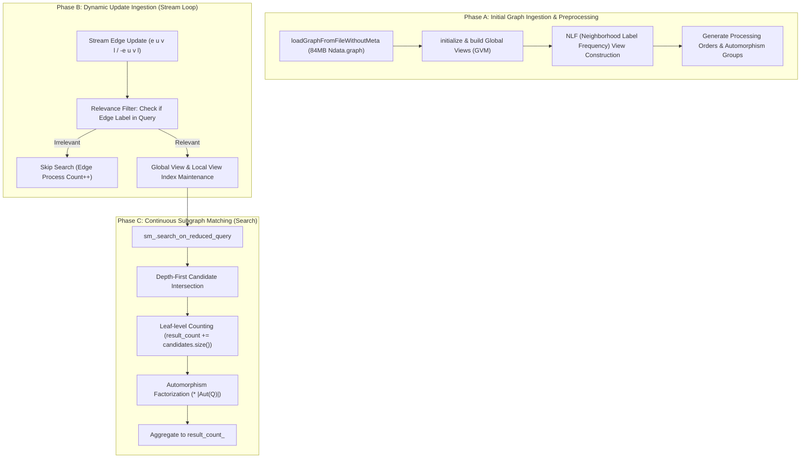

# RF-03 Candidate Bottlenecks & Profiling Hypotheses (Groundwork for Gate G3 / RF-04)

**Parent Roadmap:** [#1 — [ROADMAP] RapidFlow × NetFlow](https://github.com/iamqthanq/Seminar_RapidFlow/issues/1)  
**Parent Issue:** [#9 — [RF-03] Reproducible NetFlow COUNT-ONLY baseline and workload audit (G2)](https://github.com/iamqthanq/Seminar_RapidFlow/issues/9)  
**Target Gate:** G3 (RF-04 Profiling & Bottleneck Pinpointing)  
**Author:** AI Coding Agent / Senior Research Software Engineer  
**Date:** 2026-11-04  
**Status:** DRAFT WORKING HYPOTHESES FOR RF-04  

---

## 1. Scope, Methodology & Epistemic Boundaries

This document synthesizes empirical observations from Gate G2 baseline runs on the NetFlow dataset to identify **candidate performance bottlenecks and profiling hypotheses** for investigation in RF-04 (Gate G3).

> [!IMPORTANT]
> **Epistemic Constraint:** Execution time, wall-clock measurements, and top-level search counters from the unmodified baseline **CANNOT** prove the presence of avoidable algorithmic redundancy on their own. High execution time can stem from either:
> 1. Unavoidable intrinsic output volume (e.g., millions of matching embeddings produced by high-degree hub combinations), or
> 2. Avoidable search overhead (e.g., redundant candidate generation, sub-optimal join orders, unpruned intermediate state explosions).
>
> In Gate G2, we strictly record baseline facts and articulate falsifiable hypotheses. We do **not** claim algorithm improvements, do **not** introduce UACR or heuristic patches, and do **not** assert paper-superiority.

---

## 2. Deconstruction of RapidFlow Execution Phases

RapidFlow decomposes dynamic continuous subgraph matching into three primary architectural stages (`streaming/streaming_engine.cpp`):



### 2.1. Phase A: Static Preprocessing & Index Construction
- **Observations:** On the $3.1\text{M}$ vertex, $2.8\text{M}$ edge NetFlow graph, initial ingestion takes approximately $6.0$–$6.5\text{s}$ wall time, with subsequent `Preprocessing time` of $1.7\text{s}$ to $3.3\text{s}$ depending on query topology and edge labels.
- **Memory Footprint:** Peak RSS is stable between $836\,\text{MB}$ and $1{,}065\,\text{MB}$, remaining well within the $3\,\text{GiB}$ threshold.
- **Decomposition:** Global view and NLF index generation scale with the degree distribution of vertices matching query edge labels. Inqueries matching label 0 (which has $2.8\text{M}$ edges) require larger global views ($~275\,\text{MB}$) than queries on rare labels (e.g. label 1 or 3).

### 2.2. Phase B: Relevance Filtering & View Updates
- **Observations:** RapidFlow implements an early relevance check:
  ```cpp
  // streaming/streaming_engine.cpp:115
  if (!query_graph->hasEdgeLabel(update.labels_.edge_label_)) return;
  ```
- **Stream Ingestion Profile:**
  - In `insert_p100` (100 updates), label 2 accounts for 73 updates, label 0 for 28 updates, and label 1 for 1 update.
  - Consequently, for query `Q01_auth_5v_l1` (label 1), `relevant_update_count = 1` out of 100.
  - For query `Q02_auth_5v_l0` (label 0), `relevant_update_count = 28` out of 100.
  - For query `Q03_auth_6v_l2` (label 2), `relevant_update_count = 73` out of 100.
- For queries where the edge label is absent or rare, RapidFlow spends minimal time in stream processing ($< 0.0003\text{s}$), confirming that label filtering acts as a fast short-circuit.

### 2.3. Phase C: Search Enumeration vs Output Volume
- **Observations:**
  - For chordal 5-vertex and 6-vertex queries (`Q01`, `Q02`, `Q03`, `Q04`), `result_count = 0` during the first 100 updates because no complete 5-vertex cycles or dense 6-vertex cliques were completed by the stream edges. This counter reflects only the stream delta count ($\sum \Delta_t$); it does not imply that zero embeddings exist in the initial static data graph, nor does it provide evidence of matching-order bottlenecks on dense queries.
  - In contrast, for the 4-vertex star probe `Q05_probe_star4_l0` ($K_{1,3}$, label 0), RapidFlow registered a stream-aggregated incremental count of **$16{,}514{,}940$ matches** within the 100 updates in COUNT-ONLY mode. RapidFlow does **not** materialize or output $16{,}514{,}940$ individual embedding tuples.
  - Remarkably, despite registering $16.5$ million matching embeddings in count mode, `Q05` executed in $8.52\text{s}$ wall time ($~0.014\text{s}$ stream query time) with peak RSS of $861\,\text{MB}$.
  - **Reason for High Counting Throughput:** At the leaf depth of the search tree, RapidFlow adds the size of the leaf candidate set directly (`search_engine.cpp:161`) and scales by $|Aut(Q)| = 6$ (`streaming_engine.cpp:181`), completely avoiding the generation or output of $16.5$ million explicit mapping vectors. Rapid count throughput must not be equated with full embedding materialization.

---

## 3. Candidate Bottleneck Hypotheses for RF-04

Based on baseline measurements, we formulate three testable hypotheses for Gate G3 (RF-04):

### Hypothesis H1: Dense Hub Traversal & Intermediate State Explosion on Larger Streams
- **Premise:** When queries possess high automorphism orders or vertices with high degrees matching NetFlow hubs (max degree 49,014), the search tree width can expand exponentially before reaching the leaf depth where counting short-cuts apply.
- **Profiling Target:** Instrument the search engine to record the depth-by-depth branch factor and total nodes visited ($N_{\text{visited}}$) versus valid leaves ($N_{\text{leaves}}$).
- **Test:** If $N_{\text{visited}} \gg N_{\text{leaves}}$, significant unpruned exploration occurs, confirming an algorithmic bottleneck candidate.

### Hypothesis H2: Global View Update Overhead vs Search Activation Ratio
- **Premise:** For high-frequency stream edge labels (label 2 comprises 73.7% of updates), every relevant update modifies the global adjacency indices even when no matching embedding is formed (`search_count` remains 0 or low).
- **Profiling Target:** Separate `Global view update time` and `Local view update time` from actual `Search time` across larger stream prefixes (e.g. 500 to 1,000 updates).
- **Test:** Determine whether view maintenance constitutes an increasing fraction of total query time under churn workloads where search yields few matches.

### Hypothesis H3: Asymmetry Between Insertion and Deletion Dynamics
- **Premise:** During edge deletion (`Update::op_ == REMOVE`), RapidFlow must execute search on the *pre-deletion* graph snapshot before retracting the edge from index structures. If deletion occurs on a hub edge, the retraction cost and invalidated match enumeration might exhibit latency spikes compared to incremental insertion.
- **Profiling Target:** Measure per-update latency distributions (min, median, p95, max) for `insert_p100` versus `delete10_p100` and identify outlier update spikes.

---

## 4. Specific Requirements for RF-04 Profiling Harness

To satisfy Gate G3 without violating repository safety:
1. **Source-level Counters Required:**
   - Total search tree nodes visited: `uint64_t g_nodes_visited`
   - Total candidate intersections performed: `uint64_t g_intersections_count`
   - Total candidates pruned by NLF vs visited: `uint64_t g_nlf_pruned_count`
   - Microsecond breakdown of `global_view_update` vs `search_on_reduced_query`.
2. **Minimal Non-Invasive Instrumentation:**
   - Any instrumentation in RF-04 must reside in a separate feature branch (`feature/rf04-profiling`).
   - Instrumented counters must be verified against uninstrumented baseline outputs (`Result count` must remain exactly identical).
3. **No Premature Optimization:**
   - Do not implement pruning heuristics or structural modifications until profiling data pinpoints exact bottleneck lines.
